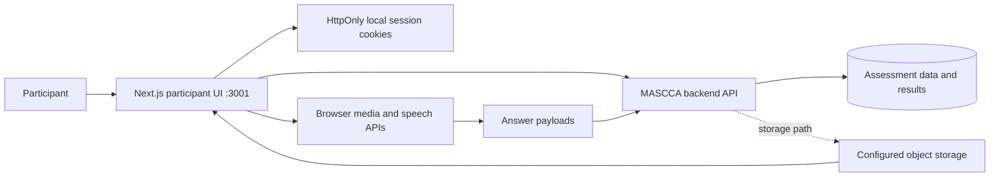

<div align="center">

# MASCCA User Frontend

**The participant-facing Next.js client for discovering, taking, and reviewing multimodal assessments in the MASCCA prototype.**

[Quick start](#quick-start) · [Capabilities](#capabilities) · [Architecture](#architecture) · [Configuration](#configuration) · [Privacy](#security-privacy-and-fairness)

</div>

## What is it?

This repository contains the participant side of MASCCA, a multi-service assessment prototype. It includes account flows, assessment discovery, invitation handling, timed test-taking, text and audio answers, browser speech recognition, camera-based expression capture, submission, and result views.

The frontend is not a standalone application. It relies on the separate MASCCA backend for identity, assessment data, submissions, storage paths, and results. Several capabilities use browser media APIs and therefore depend on browser support and explicit participant permission.

## Quick start

Prerequisites: Node.js 20+, npm, and a compatible MASCCA backend running locally or in a non-production environment.

```bash
git clone https://github.com/jayanth-mkv/mascca-user-frontend.git
cd mascca-user-frontend
npm ci
cp .env.example .env.local
npm run dev
```

Open <http://localhost:3001>. Configure the backend and related application origins in `.env.local` before testing an end-to-end invitation or submission flow.

## Capabilities

### Participant journey

- Register or sign in and browse available assessments.
- Open instructor-issued assessment links and view test instructions.
- Complete timed text and audio questions and submit the assessment.
- Review previously taken tests and result data returned by the backend.

### Browser-assisted input

- Record microphone input and create an editable browser speech transcript.
- Capture camera frames for the prototype's local face/expression analysis components.
- Upload audio answers and retrieve stored audio from a configured public storage origin.

### Current scope

The application is an experimental interface, not a validated proctoring, grading, recruitment, or education product. Browser expression estimates and AI-derived results can be inaccurate and should never be used as the sole basis for a consequential decision.

## Architecture



Authentication and authorization decisions belong to the backend. Middleware in this repository is a navigation guard, not a substitute for resource-level authorization.

## Configuration

All variables are browser-visible because they begin with `NEXT_PUBLIC_`; they must contain origins and public endpoints only.

| Variable | Purpose |
| --- | --- |
| `NEXT_PUBLIC_BACKEND_URL` | MASCCA backend origin |
| `NEXT_PUBLIC_FRONTEND_URL` | Canonical participant-app origin |
| `NEXT_PUBLIC_INSTRUCTOR_URL` | Instructor-app origin for cross-application links |
| `NEXT_PUBLIC_STORAGE_URL` | Public storage base URL used to retrieve submitted audio |

Do not put database credentials, signing secrets, provider keys, or private storage keys in any `NEXT_PUBLIC_` variable.

## Security, privacy, and fairness

- Local `.env` files are ignored; the tracked example contains placeholders only.
- Credential login establishes HttpOnly, `SameSite=Lax` session cookies through a same-origin route instead of placing the token and participant profile in a redirect URL.
- The legacy OAuth callback still accepts a short-lived token from the backend redirect before immediately replacing the URL. A production design should replace this with a one-time authorization-code exchange.
- Assessment secrets, tokens, participant profiles, transcripts, audio objects, and expression results are no longer logged by the primary test-taking and login paths.
- Configure HTTPS, strict backend CORS, short token lifetimes, refresh/revocation, resource-level authorization, upload limits, malware scanning, private storage, and audited deletion before deployment.
- Obtain explicit informed consent for microphone/camera processing. Publish retention and deletion rules, provide a non-biometric alternative, test for demographic bias, and retain human review and appeal paths.
- Rotate any secret that previously appeared in Git. Deleting a tracked `.env` file does not revoke a value or erase earlier history.

## Development checks

```bash
npm run lint
npm run build
```

No dedicated automated test suite is currently configured. Manually verify registration, login, invitation access, permission denial, text/audio submission, timeout behavior, duplicate submission protection, and cross-user authorization against a disposable backend.

## Related services

- [`mascca-main-backend`](https://github.com/jayanth-mkv/mascca-main-backend) — API and persistence layer
- [`mascca-instructor`](https://github.com/jayanth-mkv/mascca-instructor) — instructor authoring and review dashboard

## License

No license file is currently included. Unless one is added, the repository remains under default copyright terms.
